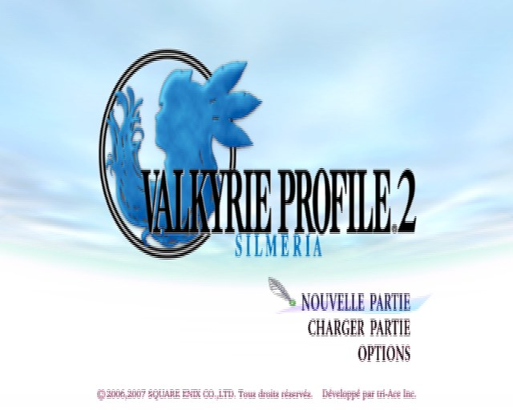
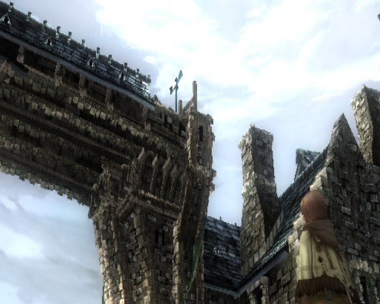
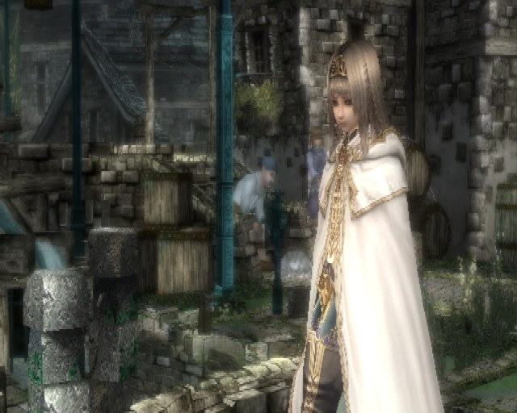
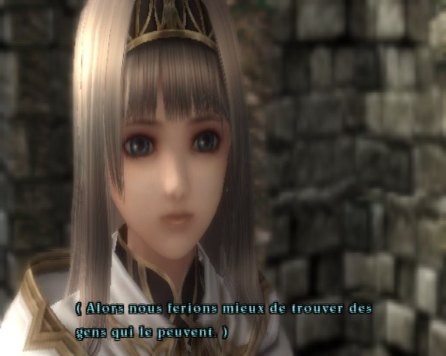

<div align="center">

# VP2S_Recomp

**A native Windows port of *Valkyrie Profile 2: Silmeria* (PAL, `SLES-54645`), made by statically recompiling the game's PlayStation 2 code to C++.**<br>
Not an emulator: the game's own MIPS R5900 code, rebuilt as a Windows program on a reimplementation of the PS2 hardware.


</div>

> [!IMPORTANT]
> No game files are included: no ELF, overlay modules, IOP modules, decryption key, or code generated from them.
> You need **your own copy** of the PAL release, PS2 ID **`SLES-54645`**. The port is built against that disc's executable:
>
> | File | SHA-1 |
> |---|---|
> | `SLES_546.45` | `541fa8d563b2834350fd0a635a4d3631574ad778` |
>
> `tools/extract.py` records the hash it finds in `build/extract/manifest.json` (`boot_sha1`).

## Status

**Work in progress, playable through the start of chapter 1.** The game boots to the title screen with music; **New Game** plays the opening movie and the chapter 1 cutscenes up to the port of Logun, where Alicia explores the town; leaving it leads to the battle tutorial, the first battles, the menus and saving to the memory card (played with a gamepad on 2026-10-28). The field and the town run at the PAL rate (50 VSync/s, 48 to 50 distinct pictures per second).

| Milestone | |
|---|:---:|
| Extract, decrypt and decompress the 25 overlay modules from the disc | ✅ |
| Recompile the main ELF and all 25 modules (7,196 functions, about 9 million lines of C++) | ✅ |
| Boot: EE kernel, the game's own IOP modules, CD reads from the disc image | ✅ |
| Overlay decryption key computed by the game on VU0 | ✅ |
| Memory card detection and controller | ✅ |
| Logos and title screen | ✅ |
| Title and in-game music (VU1 synthesis, SPU2 AutoDMA) | ✅ |
| Opening movie (MPEG-2 decoded with FFmpeg) | ✅ |
| New Game: chapter title card, first field cutscene with subtitles | ✅ |
| Field 3D rendering | ✅ |
| Chapter 1 cutscenes up to Logun; Alicia controllable in the town | ✅ |
| Field and town at full speed | ✅ |
| Leaving Logun, battle tutorial, first battles, menus, saving | ✅ |
| Rest of the game (modules captured as they are met, see below) | 🔧 |
| Widescreen, higher resolution | ⏳ |

✅ works · 🔧 in progress · ⏳ not reached yet

### Toward a full recompilation

The goal is a real PC port of the game, not a PS2 emulator around recompiled code: every part of the game is to run as
native code, with no PS2 hardware simulated (no vblank cap, real frame time, a modern renderer), agreed with the other
PS2Recomp ports. Where it stands:

| Part | Today | Next |
|---|---|---|
| Game code (EE, MIPS R5900) | **Native C++**: the main ELF and every overlay module, including the modules the disc hides behind an extra encryption layer, captured from memory the first time the game loads them and recompiled | Decrypt that layer to extract all of them (about 350) at once |
| VU0 (macro mode) | **Native**: recompiled with the EE code | |
| VU1 mesh microprogram (pc 0x0880, almost every model) | **Native C++** (`port/vp2s_vu1_hle.cpp`): same GS output, every drawn vertex checked against the VU1 traces | Its last cases (set-up routine 36, lighting mode 3), the three small microprograms left |
| GS (graphics) | **Native renderer** (default): the models are drawn directly from the native microprogram's vertices, with no GS packets built for them, into an OpenGL backend that also draws the rest of the GS stream (menus, text, effects) and reads textures from a GPU copy of GS memory. paraLLEl-GS stays as a fallback (`PS2X_GS_RENDERER=parallel`) | The 2D and effect draws as native passes too, higher internal resolution |
| VIF1 / DMA | Emulated | Feed the native microprogram from main memory |
| Frame pacing | PAL vblank by default; a native loop (`VP2S_NATIVE=1`) paces frames on the host with the real frame time | Native loop by default, frame rate menu (30, 60, unlimited) |
| IOP and sound (SPU2) | **Native IOP modules**: the ten modules the game loads (its sound driver included) are dumped once (`PS2X_IOP_DUMP_MODULES`), recompiled to C++ by `tools/iop_recomp.py` (shared with the TMB, JC2 and TTA ports) and run in place of the interpreter; emulated SPU2 | A native mixer on wall time (`PS2X_SPU2_WALLCLOCK`, from the TMB port) |


Captured from `vp2s.exe` (PAL release, French text).

| | |
|:---:|:---:|
|  |  |
| Title screen | First field scene: the town gate |
|  |  |
| Alicia in the town | Subtitled dialogue |

[docs/RECOMPILER.md](docs/RECOMPILER.md) records what works, every fix and how it was found, and what remains open. [docs/AUDIT.md](docs/AUDIT.md) is the initial feasibility audit: disc layout, overlay modules, compression and encryption formats, VU microcode.

## Goal

A fully playable *Valkyrie Profile 2: Silmeria* as a native executable, from the opening movie to the credits. Accuracy first; once it is playable, widescreen and higher internal resolution.

## How it works

```
disc image ──► tools/extract.py ──► main ELF + 25 overlay modules (decrypted, decompressed)
                                           │
               Ghidra (headless, EE) + find_entry_points.py ──► function maps
                                           │
                                     ps2_recomp ──► C++ (one file per function)
                                           │
   PS2Recomp runtime: EE kernel HLE · DMAC · GIF/GS · VIF/VU0/VU1 · IPU ─┼─► vp2s.exe
   PS2Recomp IOP:     R3000A interpreter running the game's own IRX · SPU2 · SIO2
```

- The game loads most of its code at run time as overlay modules, stored encrypted (SLE) and compressed (SLZ) on the disc. `tools/extract.py` unpacks them; `tools/wrap_elf.py` wraps each one in an ELF at its load address.
- Ghidra (with the Emotion Engine extension) maps the functions; `tools/find_entry_points.py` adds those reached only through pointers or from another module.
- PS2Recomp turns every function into C++. Overlay calls are dispatched by slot, so a module's code runs only while it is resident.
- `port/` links the generated code with the PS2Recomp runtime into `vp2s.exe`, and adds the VP2-specific front end and diagnostics.

The PS2Recomp fork lives in `external/PS2Recomp` (git submodule, [boubou666/PS2Recomp](https://github.com/boubou666/PS2Recomp)). Most runtime fixes made for this port land there, for example scratchpad chain DMA, the VU FMAC addition rounding and VU1 data access from the EE.

## Requirements

- Windows 10 or 11, Python 3.10 or later
- Visual Studio 2022 Build Tools ("Desktop development with C++": MSVC, CMake, Ninja), found with `vswhere` or `VP2S_VS_DIR`
- Ghidra (`GHIDRA_INSTALL_DIR`) and the Emotion Engine extension zip for that Ghidra version (`VP2S_GHIDRA_EE_ZIP`)
- Your own disc image of `SLES-54645` (check the hash above)
- The 16-byte SLE key, in `VP2S_SLE_KEY` or `build/sle_key.txt` (32 hex digits). It is not distributed. The game computes it at boot and keeps it at `0x1d5930`; see `load_sle_key` in `tools/slz.py`.

## Build and run

```powershell
git clone --recurse-submodules https://github.com/boubou666/VP2S_Recomp.git
cd VP2S_Recomp
python tools/pipeline.py
```

The pipeline runs these stages: `extract`, `wrap`, `ghidra`, `tool`, `sdk`, `entries`, `recomp`, `report`, `port`, `test`. Each stage skips work whose outputs are up to date. Options: `--only <stage>`, `--from <stage>`, `--force`, `--inputs main,mod003`. The first full build takes a while: the recompiled code is about 360 MB of C++.

Run the game:

```powershell
build\port\vp2s.exe build\extract\iso\SLES_546.45
```

The disc image is found through `VP2S_ISO`, or by searching upward from the ELF's folder.

A controller is used when one is connected; otherwise the keyboard (US key positions):

| PS2 button | Keyboard |
|---|---|
| D-pad | Arrow keys or W A S D |
| Cross / Circle / Square / Triangle | X or Space / C or Esc / Z or Numpad 0 / V or Numpad 1 |
| L1 / R1 / L2 / R2 | Q / E / Left Shift / Right Shift |
| Start / Select | Enter / Tab |

| Key | What it does |
|---|---|
| F1 | Runtime debugger |
| F3 | Show or hide the counter at the top right: frames shown per second and EE speed (% of real time) |
| F9 | Screenshot of the game screen (`vp2s_shot_N.png`) |

<details>
<summary><b>Runtime and diagnostic options</b></summary>

| Variable | Effect |
|---|---|
| `VP2S_ISO=<path>` | Disc image to read |
| `VP2S_SLE_KEY=<32 hex digits>` | SLE key for the extractor (or `build/sle_key.txt`) |
| `VP2S_DIAG=1` | Every 5 s: PC, resident modules, guest threads, IOP and GS state, and a screenshot (`vp2s_diag_N.png`) |
| `VP2S_PROFILE=<seconds>` | Sampling profiler: where the busiest host threads spend their time |
| `VP2S_HANG_DUMP=<seconds>` | If the display freezes that long, write every host thread's stack to `vp2s_hang.txt`; also on stack overflow |
| `VP2S_GS_SYNC=1` | Rasterize on the game thread instead of the GS worker threads |
| `PS2X_VIF1_THREAD=0`, `PS2X_GS_LAG=0` | Run VIF1 and the VU1 microprograms on the game thread (by default a worker thread with its own clock runs them: about 12% faster on the field) |
| `PS2X_GS_PIXEL_CYCLES=256`, `PS2X_GS_PRIM_CYCLES=32` | Model the GS drawing time again (VP2S sets both to 0: the GS events reach the game as soon as a frame is submitted, which keeps the GPU renderer from holding the game back; about 25% faster in towns) |
| `PS2X_VIF1_SLACK=0` | Run the EE in lockstep with the VIF1 worker again (VP2S lets the EE run ahead of it: the two overlap and the town reaches full speed; a smaller value bounds the lead in EE cycles) |
| `VP2S_VBLANK_HOLD=1` | Hold a vblank (up to 6 ms, `VP2S_VBLANK_HOLD_US`) while VP2 is still drawing its frame |
| `PS2X_SHOW_FPS=0` | Start with the fps and EE speed counter hidden (F3 toggles it) |
| `PS2X_IOP_THREAD=0` | Run the IOP on the game thread (by default it has a thread of its own: about 7% faster on the field) |
| `VP2S_NATIVE_MESH=0` | Send VP2's models to the native renderer as GS packets instead of native draws (comparison) |
| `PS2X_GS_RENDERER=parallel`, `=cpu` | Use the emulated GS instead of the native renderer: [paraLLEl-GS](https://github.com/Arntzen-Software/parallel-gs) (Vulkan compute) or the CPU rasterizer |
| `VP2S_WALLCLOCK_CATCHUP=1` | Fast-forward emulated time to wall-clock time (off by default: it starves the music thread) |
| `VP2S_DUMP=<address>:<size>`, `VP2S_WATCH=<address>,…` | Dump a memory range, or print memory words on every diagnostic pass |
| `PS2X_PAD_SCRIPT=t:BUTTON[/ms],…` | Scripted button presses (seconds from start), for unattended runs |
| `PS2X_MPEG_SKIP=<n>` | End every movie after n pictures (New Game reaches the first field scene about 160 s sooner). For tests; use 30: ending VP2's New Game movie after its first picture (=1) leaves a black screen in about 1 run in 3. `25:SQUARE,30:START,36:START,42:CROSS` then starts a new game |
| `PS2X_GS_DUMP=<dir>`, `PS2X_GS_DUMP_AFTER=<s>` | Log the next 4000 GS primitives with their state, textures and VRAM |
| `PS2X_VU1_RECORD=<file>` | Record VU1 microprogram runs for the `ps2_vu1_replay` tool |

[tools/README.md](tools/README.md) documents every pipeline stage and option.

</details>

## Known issues

- **Frame rate:** the first field scene runs at 50 VSync/s, the town of Logun at 49 VSync/s with about 43 distinct pictures per second.
- **Played so far:** chapter 1 from Logun to the battle tutorial, a first battle and a save (2026-10-28).
- **Modules found at run time:** about 350 overlay modules (battle, party, enemies) are not in the disc's plain SLZ/SLE
  chains: their files carry another layer of encryption that the game removes in memory. The port saves each one the
  first time the game loads it (`build/captured_modules/`, never committed) and `tools/pipeline.py` recompiles it; a
  run that meets a new one stops on it until the next build.

## Repository layout

| Path | Contents |
|---|---|
| `tools/` | Pipeline, disc extractor, ELF wrapper, SLZ/SLE library, entry-point finder |
| `port/` | Native front end: entry point, game-specific overrides, diagnostics, profiler |
| `ghidra_scripts/` | Headless Ghidra scripts (export for PS2Recomp, audits) |
| `scripts/` | One-off analysis and check scripts |
| `docs/` | Feasibility audit and recompilation log |
| `external/PS2Recomp` | PS2Recomp fork (submodule) |

Everything derived from the game (`build/`, `extracted/`, `out/`, `work/`, `ghidra/`, disc images) is git-ignored. Never commit or redistribute it.

## Credits

- [PS2Recomp](https://github.com/ran-j/PS2Recomp) by ran-j and contributors (GPL), the recompiler and runtime this port is built on.
- The Drakengard recompilation, developed alongside this port on the same PS2Recomp fork; many runtime fixes (GS, VU1, scheduler) are shared.
- *Valkyrie Profile 2: Silmeria* © tri-Ace / Square Enix. This is an unofficial fan project, not affiliated with or endorsed by them.
